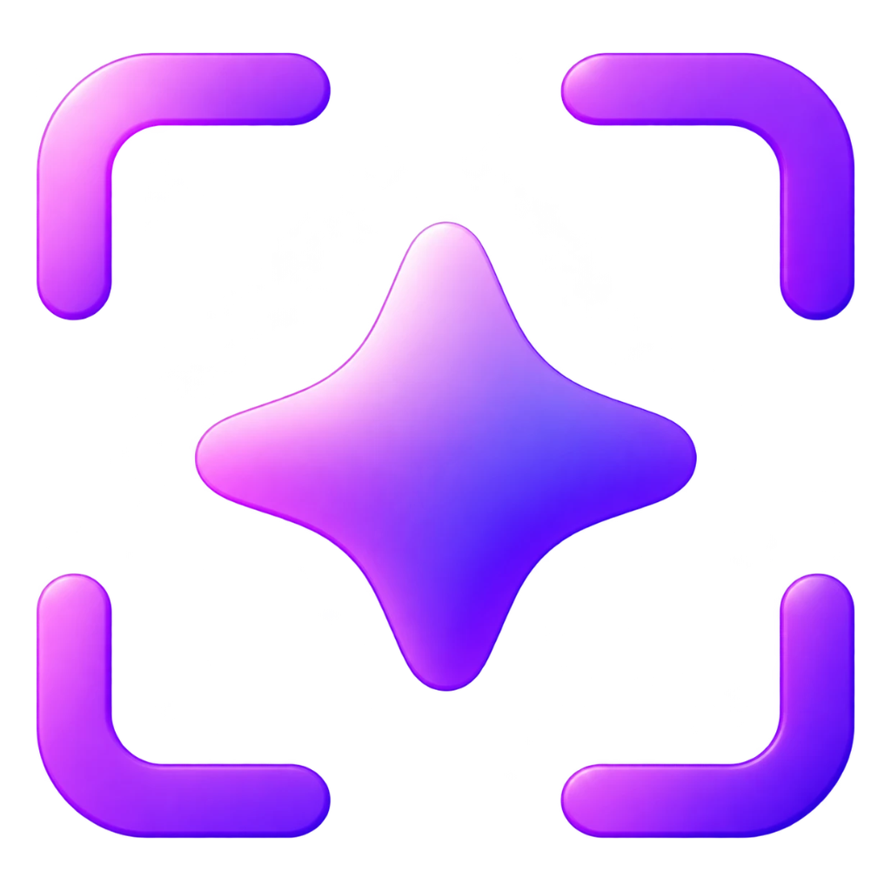

<p align="center"></p>

# ScreenSage

A small glass window for Windows that answers whatever question is on your
screen. Fit the frame around it, press **Answer**, done.

## Features

- **Answer on demand.** Nothing is captured or sent until you press Answer
  (or `Ctrl + Shift + Space`).
- **Clear answers.** The answer comes first, big. The working out folds away
  underneath.
- **Wrong answer?** One button makes it look again and correct itself.
- **Glass frame.** Drag it by its toolbar, pull any edge or corner, or draw a
  new area. It can shade everything outside it.
- **Recents.** Past answers with their captures; click a capture to see it
  full size.
- **Timer.** A tiny glass countdown (or stopwatch) that floats on top.
- **Everywhere.** Stays on every virtual desktop and works across screens.
- **Local or cloud.** Free and local with Ollama or LM Studio, or your own key
  for Claude, OpenAI, Gemini or OpenRouter (stored encrypted on your PC).

## Install

This is the final release; no further updates are planned.

Download the installer from [Releases](../../releases) and run it. It isn't
code-signed, so Windows SmartScreen may ask first: **More info → Run anyway**.

Uninstalling asks whether to delete your local data too. You can also clear
it any time in **Settings → Storage**.

## Run from source

```bash
npm install
npm start
```

Build the installer with `npm run dist` (output in `dist/`). If the build fails
with a "could not open file" error, the folder path is too long: move the
project somewhere shorter, such as `C:\dev\screensage`.

## Privacy

Only the area inside the frame is captured, and only when you press Answer.
With Ollama or LM Studio nothing leaves your computer. With a cloud provider
the capture goes to that provider. Recents and settings stay on this PC.
